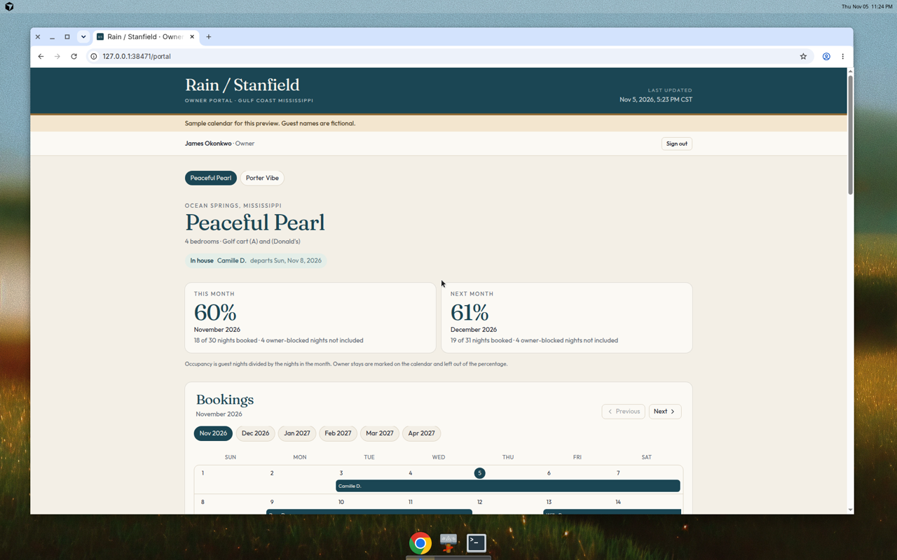
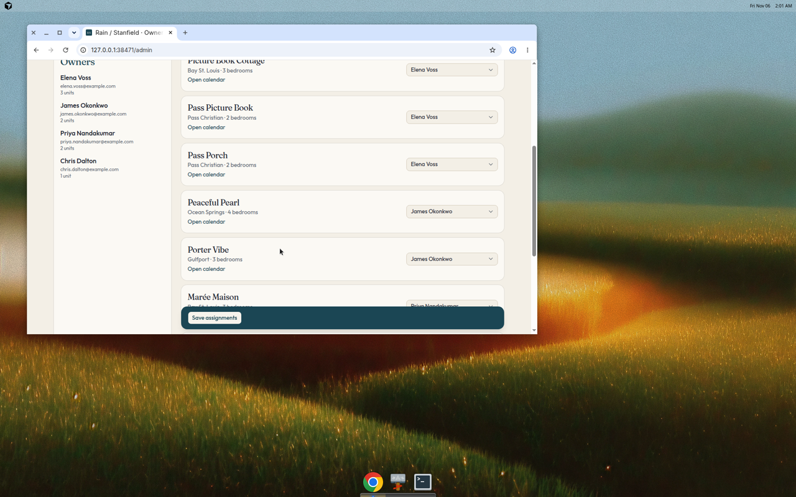
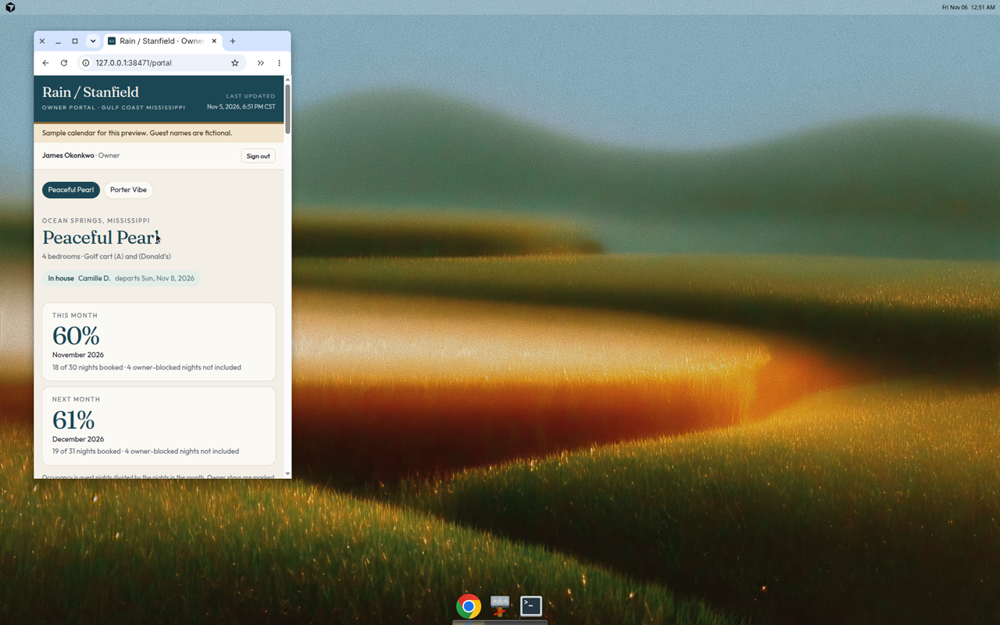

# Rain / Stanfield owner portal

A private preview for short-term-rental owners on the Mississippi Gulf Coast. An owner signs in and sees only the houses assigned to them: a six-month booking calendar, upcoming stays, and occupancy for this month and next. Peaceful Pearl, Porter Vibe, and Porter Pulse #19 also show a golf-cart calendar.

This is a local preview. It is not deployed, and it is not ready for production hosting.

## Run the preview

```bash
npm install
cp .env.example .env.local
npm run dev
```

Open [http://127.0.0.1:38471](http://127.0.0.1:38471). `.env.local` already sets `DATA_MODE=mock`, so the app starts with fictional guests and a sample cart calendar. No Hostaway or Google credentials are required.

The sample banner on every page says the names are fictional. Guest names are stored in full inside the mock source and shortened before they reach the screen, the same way a live Hostaway record is shortened.

### Preview sign-in

| Who | Email | Password | Sees |
| --- | --- | --- | --- |
| James Okonkwo | james.okonkwo@example.com | coastal-preview | Peaceful Pearl, Porter Vibe |
| Elena Voss | elena.voss@example.com | coastal-preview | Picture Book Cottage, Pass Picture Book, Pass Porch |
| Priya Nandakumar | priya.nandakumar@example.com | coastal-preview | Marée Maison, Porter Bloom |
| Chris Dalton | chris.dalton@example.com | coastal-preview | Porter Pulse #19 |
| Marina Cole (admin) | marina.cole@rainstanfield.example | preview-admin | Every unit, plus owner assignments |

These accounts are fictional. Replace them before any real owner uses the portal.

Mock mode is the local default. `DATA_MODE=live` is the production path described in [DEPLOY.md](DEPLOY.md). `PREVIEW_PASSWORD` locks a hosted mock preview only. Live mode does not use that gate.

## Host the preview on Netlify’s free plan

Netlify can build this Origin repo on the free plan. Its own site password is a paid Pro feature, so the password check lives in this app.

1. Create a free account at [https://app.netlify.com/signup](https://app.netlify.com/signup).
2. Choose **Add new project**, then **Import an existing project**, then **Cursor Origin**. Sign in with the Cursor account that can see this repo.
3. For a sample preview, set `DATA_MODE` to `mock`, plus `PREVIEW_PASSWORD` and `SESSION_SECRET`. For the live site, follow [DEPLOY.md](DEPLOY.md) instead.
4. Leave the project **Private**. On the free plan that login wall is only the team owner.
5. Deploy. The site is `https://<the-name-you-pick>.netlify.app`.

Build command is `npm run build`. Node 22. Netlify supplies the Next.js runtime. No publish directory.

## What an owner sees

- The house name, town, and a **last updated** time in US Central time.
- Occupancy for this month and next month: guest nights divided by the nights in the month. Owner blocks are drawn on the calendar and listed beside the percentage, and they are not included in it.
- A month-by-month calendar from November 2026, or from the current month once that is later, for six months. Checkout morning is not a booked night.
- Upcoming stays, including anyone in the house today. Columns are guest, dates, nights, channel, and status.
- A second calendar when the house has a golf cart.

Cancelled, declined, and inquiry reservations are hidden, including Hostaway's `inquiryPreapproved`, `inquiryDenied`, `inquiryTimedout`, and `inquiryNotPossible` variants, plus the American spelling `canceled`. Expired holds are hidden too, because they are not stays.

Pending and awaiting-payment holds stay on the calendar. Those nights are not free, so they count as occupied and are labeled as holds.

## What is never shown

Guest names are a first name and last initial (`Camille D.`). The portal does not show payments, payouts, card details, guest email, phone, address, door codes, or internal notes. Cart-event descriptions are not read. A phone number or email stuffed into a calendar title is stripped.

## Plug in Hostaway

1. In Hostaway, copy the account ID and API secret key.
2. In `.env.local`:

```bash
DATA_MODE=live
HOSTAWAY_ACCOUNT_ID=your-account-id
HOSTAWAY_API_KEY=your-api-secret
```

Or set `HOSTAWAY_TOKEN` to a bearer token you already have. A token is used as-is. Otherwise the app requests one from `POST https://api.hostaway.com/v1/accessTokens` with `grant_type=client_credentials` and `scope=general`, then calls `GET /v1/listings` and `GET /v1/reservations`.

Listings are matched to `config/units.json` by `hostawayListingId` when that field is set, and otherwise by listing name (`Marée Maison` matches with or without the accent). If a name in Hostaway differs, put the numeric listing id on that unit.

Live mode does not fall back to the sample guests. If Hostaway rejects the credentials, the calendar page explains that and leaves the sample data off.

## Plug in the golf-cart calendar

Cart rentals come from the Google Calendar named **STR Golf Cart Rentals**. Event titles carry a unit tag:

| Tag in the title | House |
| --- | --- |
| `(A)` | Peaceful Pearl |
| `(Donald's)` | Peaceful Pearl |
| `(7A)` | Porter Vibe |
| `(19)` | Porter Pulse #19 |

Curly apostrophes in `(Donald's)` still match. `(7A)` is not treated as `(A)`. Edit the mapping in [`config/cart-tags.json`](config/cart-tags.json). Events with no tag are skipped, and the admin page counts them.

In Google Calendar, open **STR Golf Cart Rentals → Settings and sharing → Integrate calendar**, and copy the **Secret address in iCal format**. Put it in `.env.local`:

```bash
GOLF_CART_ICS_URL=https://calendar.google.com/calendar/ical/.../basic.ics
```

That URL is a secret. Do not commit it. With `DATA_MODE=live`, the portal reads the feed. With `DATA_MODE=mock`, it parses a built-in sample through the same iCal code.

All-day events use the iCal rule that the end date is exclusive. Timed events are shown on the Central-time dates they cover.

## Assign houses

Sign in as Marina and open **Manage owners**. Each house has one owner. On your own computer, saving writes `data/assignments.local.json`, which is gitignored, so the committed seed in `config/assignments.json` stays as the default. The Netlify preview cannot save those edits. The seeded owners stay in place.

## Static file drop

`npm run build:static` writes a browser-only copy to `static-drop/` for [Netlify Drop](https://app.netlify.com/drop). It uses the sample owners and a client-side preview password. The Next.js app on `main` is unchanged and still needs a server.

## Scripts

```bash
npm test   # privacy, occupancy, iCal tags, and owner filtering
npm run lint
npm run dev
```

## Screenshots

Captured from the local preview with sample data:







## Live site

The production path is `DATA_MODE=live` on the Netlify site. See [DEPLOY.md](DEPLOY.md). Mock mode and `npm run build:static` remain for sample previews.
